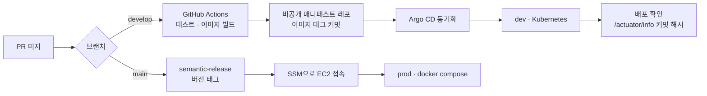

# 바른보상 Backend

보험금 결과에 의문이 있는 사용자에게 AI 리포트와 손해사정사 상담을 연결하는 서비스의 API 서버

[위키](https://github.com/SM17-YoonDongJu/Backend/wiki) · [사례 기록](https://github.com/SM17-YoonDongJu/Backend/wiki#사례-기록) · [결정 로그](https://github.com/SM17-YoonDongJu/Backend/wiki/Decision-Log) · [배포 가이드](deploy/README.md) · [용어집](https://github.com/SM17-YoonDongJu/Backend/wiki/Glossary)

## 목차

- [소개](#소개)
- [주요 화면](#주요-화면)
- [아키텍처](#아키텍처)
- [핵심 기술 경험](#핵심-기술-경험)
- [기술 스택](#기술-스택)
- [로컬에서 실행하기](#로컬에서-실행하기)
- [프로젝트 구조](#프로젝트-구조)
- [개발 규칙](#개발-규칙)
- [배포](#배포)

## 소개

손해보험 피해구제 신청의 87\~90%가 보험금 지급과 관련된 분쟁이다(손해보험협회, 2022\~2025 상반기). 그런데 일반 사용자는 약관과 보상 기준을 읽기 어려워, 보험사가 제시한 금액이 적정한지 스스로 판단하기 어렵다.

바른보상은 사고 정보와 진단서를 받아 AI가 관련 약관·판례·분쟁 사례를 찾고, 예상 보상 범위와 쟁점을 정리한 리포트 초안을 만든다. 이 초안은 사용자에게 바로 가지 않고, 등록된 손해사정사가 쟁점별로 검수한 뒤 전달된다. 사용자는 검수한 손해사정사들이 보낸 상담 제안을 비교해 한 명을 골라 상담을 이어 간다.

AI·SW마에스트로 17기 프로젝트로, 2026년 5월부터 개발하고 있다.

## 주요 화면

<table>
  <tr>
    <td align="center" width="25%"></td>
    <td align="center" width="40%"></td>
    <td align="center" width="35%"></td>
  </tr>
  <tr>
    <td align="center">사고·보험 정보 입력과 서류 업로드</td>
    <td align="center">손해사정사가 검수한 최종 리포트</td>
    <td align="center">전문 분야·지역 기반 손해사정사 검색</td>
  </tr>
</table>

화면의 이름과 수치는 모두 데모 데이터다.

## 아키텍처

| Spring Boot (이 레포) | AI 워커 (FastAPI, 별도 레포) |
|---|---|
| 인증·회원 (JWT, 카카오·네이버·애플 로그인, 역할 기반 인가) | OCR, 개인정보 마스킹 |
| 사고 정보·진단서 접수, S3 업로드, OCR 트리거 발행(SQS) | 하이브리드 RAG 검색, LangGraph 리포트 생성, 가드레일 |
| 손해사정사 검수·제안 수락/거절, 상담 채팅(WebSocket) | SQS 메시지 소비 이후의 처리 |
| 인앱 알림, FCM 푸시 | |

리포트 생성 요청은 이 서버가 받아 같은 트랜잭션 안에 아웃박스로 적재하고, 릴레이가 SQS로 발행한다. AI 워커가 남긴 결과와 상태(분석 실패, 가드레일 차단, 재업로드 필요)는 스케줄러가 읽어 알림으로 바꾼다.

## 핵심 기술 경험

개발하며 겪은 문제는 측정 → 원인 → 대안 → 조치 → 검증 순서로 위키에 사례 기록을 남긴다. 그중 다섯 가지를 소개한다.

**리포트 접수가 부하에서 무너진 이유는 사건번호였다.** 혼합 시나리오 부하테스트에서 실패율이 23\~37%까지 올라갔다. 원인은 리포트마다 사건번호를 발급하는 과정의 락 경합이었고, 발급 방식을 DB 시퀀스로 바꾼 뒤 단일 API 100 RPS에서 실패 0%, p95 114ms가 됐다.
→ [사건번호 발급 락 경합으로 처리량 붕괴](https://github.com/SM17-YoonDongJu/Backend/wiki/사건번호-발급-락-경합으로-처리량-붕괴)

**서버 오류는 0건인데 500이 144건 찍혔다.** dev 로그 6시간치의 500을 전부 분류해 보니 모두 404·405였다. 포괄 예외 핸들러가 4xx를 500으로 바꾸고 있었고, 고친 뒤에는 404가 로그에서 아예 사라지는 2차 문제를 한 번 더 고쳤다.
→ [서버 오류는 0건인데 500이 144건이던 포괄 예외 핸들러 문제](https://github.com/SM17-YoonDongJu/Backend/wiki/서버-오류는-0건인데-500이-144건이던-포괄-예외-핸들러-문제)

**API 문서의 프로퍼티 602개 중 599개가 실제 응답과 달랐다.** Spring Boot 4는 Jackson 3만 설정하는데, springdoc은 자체 정적 매퍼로 스키마를 만들어 snake_case 설정을 보지 못했다. 문서 생성용 매퍼를 직접 맞춰 바로잡았다.
→ [OpenAPI 프로퍼티명이 camelCase로 문서화돼 실제 응답과 어긋남](https://github.com/SM17-YoonDongJu/Backend/wiki/OpenAPI-프로퍼티명이-camelCase로-문서화돼-실제-응답과-어긋남)

**사정사 평점이 언제나 0점이었다.** 다섯 화면이 읽는 비정규화 컬럼에 값을 쓰는 코드가 없었고, 처음의 null 처리가 그 사실을 두 달 동안 가렸다. 쓰는 경로를 하나로 모으고, 비관적 잠금을 빼면 값이 누락되는 것을 재현한 뒤 잠금을 넣었다.
→ [읽는 곳은 다섯인데 쓰는 곳이 없던 비정규화 컬럼으로 사정사 평점이 항상 0점](https://github.com/SM17-YoonDongJu/Backend/wiki/읽는-곳은-다섯인데-쓰는-곳이-없던-비정규화-컬럼으로-사정사-평점이-항상-0점)

**OCR 트리거 브로커를 하루에 두 번 바꿨다.** 직접 띄운 Kafka에서 MSK로 옮긴 날, 비용과 운영 부담을 다시 따져 SQS로 전환했다. 그 과정에서 큐 이름이 빈 값으로 들어가 아웃박스 행이 전부 실패 처리됐고, 설정을 고쳐도 이미 적재된 행은 되살릴 수 없다는 걸 겪어 큐 이름 폴백을 없앴다.
→ [OCR 트리거 브로커를 Kafka에서 MSK를 거쳐 SQS로 전환](https://github.com/SM17-YoonDongJu/Backend/wiki/OCR-트리거-브로커를-Kafka에서-MSK를-거쳐-SQS로-전환)

전체 24편은 [위키](https://github.com/SM17-YoonDongJu/Backend/wiki)에 있다.

## 기술 스택

| 분류 | 사용 |
|---|---|
| 언어·프레임워크 | Java 21, Spring Boot 4.0 (Spring Framework 7, Jackson 3) |
| 데이터 | PostgreSQL 16 + pgvector, Spring Data JPA, QueryDSL, Flyway, Redis 7 |
| 인증 | Spring Security, JWT(HttpOnly 쿠키), Refresh Token Rotation(Redis Lua) |
| 실시간 | WebSocket(STOMP) 구독 + REST 전송, Redis pub/sub |
| AWS | S3, SQS, KMS(PII 봉투 암호화), RDS |
| 문서·관측 | springdoc-openapi + Scalar, Actuator, Prometheus, Grafana, Loki, Tempo |
| 배포 | Docker, GitHub Actions, Kubernetes + Argo CD(dev), EC2 + docker compose(prod) |

## 로컬에서 실행하기

필요한 것: JDK 21, Docker

1. 환경 변수 파일을 만든다. `cp .env.example .env` 후 `DB_PASSWORD`, `JWT_SECRET`(32자 이상) 등 필수값을 채운다.
2. 인프라를 띄운다. `docker compose up -d`를 실행하면 PostgreSQL(pgvector), Redis, LocalStack(SQS)이 뜨고 OCR 큐도 자동으로 만들어진다.
3. 앱을 실행한다. `SPRING_PROFILES_ACTIVE=local ./gradlew bootRun`
4. API 문서는 `http://localhost:8080/docs`(Scalar)와 `/v3/api-docs`에서 본다. 엔드포인트와 스키마는 이 문서가 기준이다.

`local` 프로파일은 쿠키 `Secure`를 끄고, API 문서를 인증 없이 열고, 개발용 로그인 엔드포인트를 켠다. 배포 환경에서는 쓰지 않는다.

| 서비스 | 로컬 포트 |
|---|---|
| API 서버 (Actuator 포함) | 8080 |
| PostgreSQL | 5432 |
| Redis | 6379 |
| LocalStack (SQS) | 4566 |

| 명령 | 용도 |
|---|---|
| `./gradlew build` | 빌드 |
| `./gradlew test` | 전체 테스트 |
| `./gradlew test --tests "com.soma.backend.domain.auth.*"` | 일부 테스트 |
| `./gradlew checkstyleMain` | 코드 스타일 검사 |
| `docker compose --profile app up -d` | 앱까지 컨테이너로 실행 |

테스트는 `test` 프로파일로 `localhost:5432`의 `test_db`(계정 `test`/`test`)와 `localhost:6379`의 Redis에 붙는다. CI는 둘을 서비스 컨테이너로 띄우고, 로컬에서는 `docker compose`로 띄운 PostgreSQL에 한 번만 만들어 두면 된다.

`docker compose exec postgres psql -U soma -d soma_db -c "CREATE ROLE test LOGIN SUPERUSER PASSWORD 'test'" -c "CREATE DATABASE test_db OWNER test"`

(`.env`에서 `DB_USER`·`DB_NAME`을 바꿨다면 `-U`·`-d` 값도 맞춘다.)

QA용 API 테스트는 Gradle과 별개인 `qa-e2e/`(Playwright) 프로젝트에 있다.

## 프로젝트 구조

도메인(Bounded Context)으로 먼저 나누고, 각 도메인 안을 레이어로 나눈다. 비즈니스 규칙은 서비스가 아니라 엔티티 메서드에 둔다.

| 경로 | 내용 |
|---|---|
| `domain/auth` | 소셜 로그인, 토큰 발급·재발급·로그아웃 |
| `domain/user` | 회원, 마이페이지, 보험 정보, 탈퇴 |
| `domain/adjuster` | 손해사정사 신청·프로필·공개 목록, 사정사 홈 |
| `domain/report` | 리포트 접수·조회, 검수, 제안 수락/거절, 분석 상태 |
| `domain/chat` | 상담 채팅방, 메시지, 첨부, 읽음 처리 |
| `domain/notification` | 인앱 알림, FCM 푸시, 알림 설정 |
| `domain/upload` | S3 presigned 업로드 |
| `global/` | 보안(JWT 필터, 쿠키), 예외 처리, 공통 응답, 설정 |
| `infra/` | Redis, S3, SQS, KMS, FCM, 아웃박스 |

각 도메인은 `controller / dto / entity / repository / service`로 나뉜다. 의존 방향은 항상 `entity` 쪽을 향하고, `entity`는 Spring Web이나 서비스를 알지 못한다.

## 개발 규칙

**응답 형식.** 성공은 `{ "status": "200", "message": "...", "data": {...} }`, 실패는 `{ "status": "400", "code": "ERROR_CODE", "message": "..." }`이고 필드명은 snake_case다. 컨트롤러는 `ApiResponse<T>`를 그대로 반환하고, 200이 아닌 성공 상태는 `@ResponseStatus`로 선언한다. 예외는 `BusinessException(ErrorCode)`로 던진다.

**인증.** 토큰은 `access_token`, `refresh_token` HttpOnly 쿠키로만 주고받는다. `Authorization: Bearer` 헤더는 지원하지 않으니, 서버 간 호출이나 부하 테스트도 쿠키를 실어야 한다.

**조회 쿼리.** native query는 쓰지 않는다. 동적 조회는 QueryDSL, 단순 조회는 Spring Data 파생 쿼리나 JPQL로 쓴다. 불가피한 경우에만 사유를 주석으로 남긴다.

**DB 마이그레이션.** 스키마는 Flyway(`src/main/resources/db/migration/V{n}__설명.sql`)로만 바꾸고 JPA는 `validate`다. 새 테이블과 인덱스는 반드시 `core.` 스키마를 붙여 만든다. 붙이지 않으면 배포 후 앱이 테이블을 찾지 못해 기동에 실패한다. 번호는 develop뿐 아니라 열려 있는 다른 PR과도 겹치지 않는지 확인한다.

**브랜치와 PR.** `feature/*` → `develop` → `main`의 Git Flow를 쓴다. 작업은 이슈를 먼저 만들고 `<type>/<이슈번호>-<요약>` 브랜치에서 한다. 커밋은 `<type>(<scope>): 한국어 설명`, PR 제목은 `<type>: #<이슈번호> 설명` 형식이다. PR은 CodeRabbit 리뷰와 팀원 1명 이상의 승인을 받아 `develop`에 머지한다. 버전 태그는 `main`에 머지될 때 semantic-release가 커밋 타입을 보고 붙인다.

## 배포

| 환경 | 방식 |
|---|---|
| local | `docker compose`(DB·Redis·LocalStack) + `bootRun` |
| dev | GitHub Actions가 이미지를 빌드해 비공개 매니페스트 레포의 태그를 갱신하면 Argo CD가 Kubernetes에 반영한다. 반영 뒤 `/actuator/info`의 커밋 해시로 배포를 확인한다 |
| prod | GitHub Actions가 SSM으로 EC2에 접속해 docker compose로 교체한다 |

운영 절차와 환경 변수는 [`deploy/README.md`](deploy/README.md), 클러스터 구성과 런북은 위키의 [Kubernetes](https://github.com/SM17-YoonDongJu/Backend/wiki/Kubernetes) 페이지에 있다.
